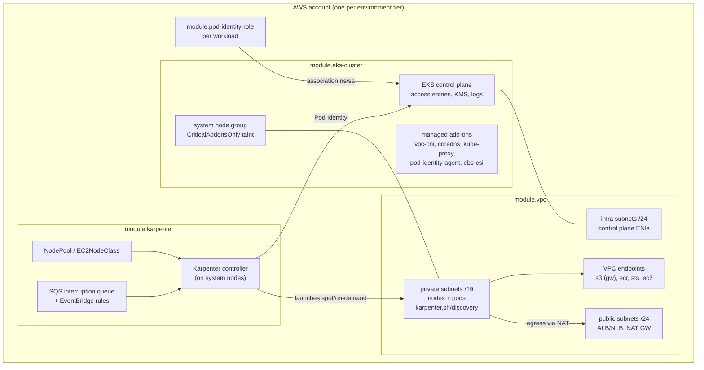

# terraform-aws-platform

[](https://github.com/lbarrosby/terraform-aws-platform/actions/workflows/ci.yml)
[](LICENSE)

Terraform modules a platform team uses to stamp out EKS clusters the same way in every account: network, cluster, autoscaling and workload identity, with the decisions already made and enforced by validation instead of by code review.

The modules are thin, opinionated wrappers over [terraform-aws-modules](https://github.com/terraform-aws-modules). The upstream modules do the heavy lifting; this repo pins them, narrows their interface and encodes the defaults.

## Modules

| Module | What it does |
|--------|--------------|
| [`vpc`](modules/vpc) | 3-tier VPC (private /19, public /24, intra /24 per AZ), NAT per AZ or single, flow logs, EKS/Karpenter discovery tags, optional VPC endpoints. |
| [`eks-cluster`](modules/eks-cluster) | EKS with access entries (no `aws-auth`), Pod Identity, tainted system node group, managed add-ons with versions resolved per cluster version, KMS secrets encryption, control plane logs, private endpoint by default. |
| [`karpenter`](modules/karpenter) | Karpenter controller role via Pod Identity, interruption queue, node role, Helm release and a default NodePool/EC2NodeClass (spot + on-demand, consolidation, hard limits). |
| [`pod-identity-role`](modules/pod-identity-role) | IAM role for a workload bound through EKS Pod Identity, trust scoped to the cluster, policies passed in as documents. |

[`examples/complete`](examples/complete) composes all four. [`live/`](live) shows how environments consume them with Terragrunt.

## Architecture



Dependency order is `vpc -> eks-cluster -> karpenter -> pod-identity-role`. Each is its own state in `live/`, so a Karpenter change never plans against the VPC.

## Conventions

### Naming

`<org>-<env>-<region_short>`, e.g. `plat-prod-use1`. The same string is the VPC name, the cluster name and the Karpenter discovery tag value, so subnets and security groups are found by tag instead of by passing IDs around. Names are validated (lowercase, length bounded so derived IAM names stay inside the 38 char `name_prefix` limit; there is a test for the maximum length).

### Tagging

Every module merges a small set of `platform:*` tags (`platform:module`, `platform:managed-by`, `platform:cluster`) with the caller's `tags`. Environment level tags (`platform:environment`, `platform:owner`, `platform:account`) come from the provider `default_tags` generated in `live/root.hcl`, so they also land on resources created outside these modules.

### Versioning

Each module is versioned independently with SemVer and released as a git tag `<module>-vMAJOR.MINOR.PATCH`:

- **MAJOR**: input removed/renamed, default with behavioural impact changed, or anything that forces resource replacement.
- **MINOR**: new input with a backwards compatible default, new output.
- **PATCH**: fixes, docs, upstream patch bumps with no plan diff.

Consume with a pinned ref, never a branch:

```hcl
module "eks" {
  source = "git::https://github.com/lbarrosby/terraform-aws-platform.git//modules/eks-cluster?ref=eks-cluster-v1.0.0"
  # ...
}
```

Upstream modules and providers are pinned exactly inside the modules (`version = "21.29.0"`); provider constraints are ranges (`>= 6.59, < 7.0`) so the root module owns the lock file.

### Identity

- Humans and CI get cluster access through **EKS access entries**. There is no `aws-auth` ConfigMap to drift.
- Workloads get AWS credentials through **EKS Pod Identity**. IRSA can be enabled per cluster for legacy charts, but it is off by default.

## Requirements

| Tool | Version |
|------|---------|
| Terraform | >= 1.11 (tested on 1.11.4 and 1.14.8) |
| AWS provider | >= 6.59, < 7.0 |
| Helm provider (karpenter only) | >= 3.0, < 4.0 |
| Terragrunt (live/ only) | >= 0.80 / 1.x |

## Testing

Every module has `tests/*.tftest.hcl` that run `terraform test` against `mock_provider` blocks. No AWS credentials, no cost. Tests cover the defaults, the toggles and the validation rules (each `expect_failures` run proves a bad input is rejected at plan time). `examples/complete` has a composition test that plans all four modules together, which is where interface drift between modules shows up.

```bash
cd modules/eks-cluster
terraform init -backend=false
terraform test
```

CI (`.github/workflows/ci.yml`) runs on every PR:

| Job | What |
|-----|------|
| fmt | `terraform fmt -check -recursive` |
| validate + test | `init -backend=false`, `validate`, `terraform test` per module, on the minimum and the current Terraform |
| tflint | recursive, `terraform` (preset all) + `aws` rulesets |
| terraform-docs | READMEs regenerated and diffed |
| trivy config | SARIF to code scanning, gate on HIGH/CRITICAL |

Locally, `pre-commit install` gives the same checks before each commit.

## License

Apache 2.0. See [LICENSE](LICENSE).
